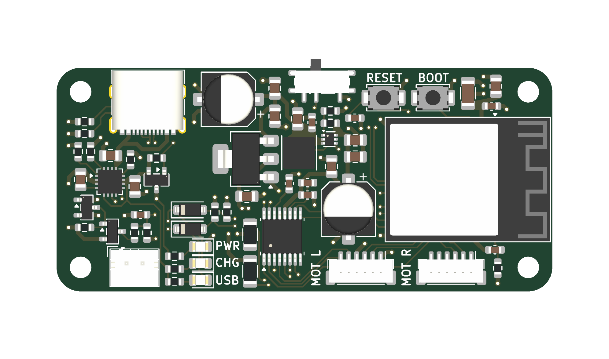

# ESP32 Diff Drive

A compact ESP32-S3 based differential drive controller board designed in KiCad.

<p align="center">
  
</p>

## Overview

_Project description coming soon._

## Features

- ESP32-S3-MINI-1 module
- USB-C power and programming
- Li-ion battery charging
- Dual motor driver outputs

## Repository Layout

```
docs/images/                     README images
ESP32_Diff_Drive/
├── ESP32_Diff_Drive.kicad_pro   KiCad project
├── ESP32_Diff_Drive.kicad_sch   Schematic
├── ESP32_Diff_Drive.kicad_pcb   PCB layout
└── libraries/                   Project symbols, footprints, and 3D models
```

## Getting Started

_Instructions coming soon._

## License

_TBD_
